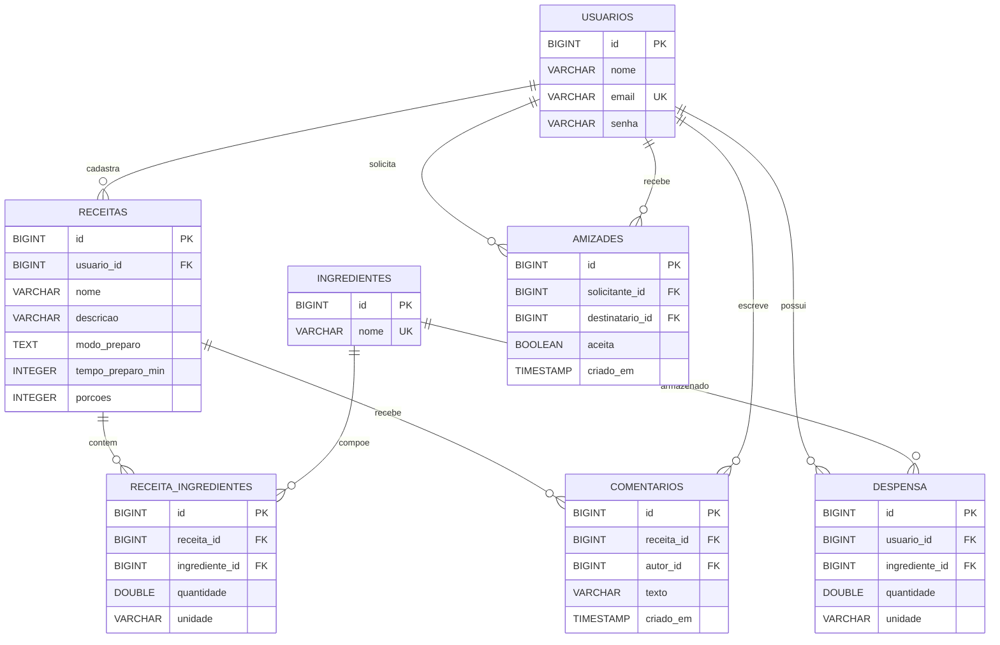

# Modelagem de dados do Cozinha em Dia

## Diagrama entidade-relacionamento

## Entidades e responsabilidades

| Entidade/tabela | Responsabilidade | Campos importantes |
|---|---|---|
| `usuarios` | Conta e dados próprios do usuário | `id`, `nome`, `email`, `senha` (hash BCrypt) |
| `receitas` | Receita cadastrada por um usuário | `id`, `usuario_id`, `nome`, `descricao`, `modo_preparo`, `tempo_preparo_min`, `porcoes`, `imagem_arquivo`, `imagem_url`, `video_url`, `video_arquivo`, `origem_nome` |
| `etapas_receita` | Etapas numeradas do preparo, cada uma com texto e foto opcional | `receita_id`, `ordem`, `descricao`, `imagem_arquivo` |
| `amizades` | Pedido de amizade entre dois usuários; vira amizade quando `aceita` é verdadeiro | `solicitante_id`, `destinatario_id`, `aceita`, `criado_em` |
| `compartilhamentos` | Receita enviada pelo dono a outro usuário | `receita_id`, `destino_id`, `mensagem`, `criado_em`, `copiada` |
| `comentarios` | Comentário de um usuário em uma receita que ele pode ver (própria ou compartilhada com ele) | `receita_id`, `autor_id`, `texto` (até 500 caracteres), `criado_em` |
| `ingredientes` | Catálogo de ingredientes reutilizável | `id`, `nome` |
| `receita_ingredientes` | Tabela associativa entre receita e ingrediente, com quantidade requerida | `receita_id`, `ingrediente_id`, `quantidade`, `unidade` |
| `despensa` | Quantidade de cada ingrediente mantida por cada usuário | `usuario_id`, `ingrediente_id`, `quantidade`, `unidade` |

## Cardinalidades

- Um usuário pode cadastrar várias receitas; cada receita pertence a um usuário.
- Uma receita pode conter vários ingredientes; um ingrediente pode aparecer em várias receitas. A tabela `receita_ingredientes` resolve esse relacionamento N:N e armazena quantidade e unidade específicas para aquela receita.
- Uma receita possui várias etapas (`etapas_receita`), mantidas na ordem em que foram cadastradas e excluídas junto com a receita.
- Um usuário pode ter vários amigos. A tabela `amizades` relaciona dois usuários (solicitante e destinatário), tem restrição de unicidade para o par e só vale como amizade depois de aceita.
- Uma receita tem vários comentários e cada comentário pertence a um autor e a uma receita. Ao excluir a receita, os comentários dela são excluídos junto.
- Uma receita pode ser compartilhada com vários usuários e um usuário pode receber várias receitas. A tabela `compartilhamentos` resolve essa relação N:N e impede que a mesma receita seja enviada duas vezes à mesma pessoa.
- Um usuário pode ter vários ingredientes na despensa; o mesmo ingrediente pode estar na despensa de vários usuários. A tabela `despensa` resolve esse relacionamento e guarda o estoque individual.

## Regras de negócio do protótipo

1. O e-mail é único e a senha é armazenada como hash, não em texto puro.
2. As páginas de receitas e despensa trabalham somente com dados associados ao usuário autenticado.
3. Quantidades precisam ser maiores que zero.
4. Ao adicionar novamente um ingrediente que já está na despensa, a quantidade é somada. Se a unidade informada for da mesma grandeza da cadastrada (por exemplo, `kg` e `g`), o valor é convertido para a unidade do item. Entre massa e volume (por exemplo, `xícara` e `g`) a conversão só ocorre se o ingrediente tiver densidade conhecida; caso contrário, ou se as unidades forem incompatíveis (por exemplo, `g` e `unidade`), o sistema recusa a operação. O item também pode ser corrigido diretamente, com nova quantidade e nova unidade.
5. Uma receita fica **disponível** quando há quantidade suficiente de todos os seus ingredientes; **parcial** quando há algum estoque correspondente, mas ainda falta quantidade ou ingrediente; e **indisponível** quando nenhum item requerido tem estoque correspondente suficiente para avançar.
6. A comparação converte o estoque para a unidade da receita quando as duas pertencem à mesma grandeza: massa (`mg`, `g`, `kg`) ou volume (`cl`, `ml`, `l`, `xícara`, `colher` e `colher de chá`, com 240 ml, 15 ml e 5 ml). Quando o ingrediente tem densidade conhecida (por exemplo, farinha de trigo a 0,5 g/ml), massa e volume também são convertidos entre si, de forma aproximada. Unidades como `unidade` e `dente` não têm equivalência fixa e só são comparadas com elas mesmas.

7. Cada receita aceita uma imagem de capa (arquivo enviado ou endereço externo), um link de videoaula do YouTube e um vídeo próprio. Os arquivos ficam em uma pasta fora do código (`app.uploads.dir`), com nome gerado pelo sistema, e o banco guarda apenas esse nome. O tipo do arquivo é conferido pelo conteúdo, e não pela extensão informada.
8. Somente o dono compartilha a receita, e apenas com amigos (amizade aceita). O pedido de amizade é enviado pelo e-mail de um usuário já cadastrado; se a outra pessoa já tinha enviado um pedido, a amizade é confirmada na hora. Desfazer a amizade não retira receitas já compartilhadas. O destinatário pode consultá-la, ver o que falta na própria despensa e salvar uma cópia independente (com ingredientes, etapas e arquivos duplicados). O dono e o destinatário podem desfazer o compartilhamento.
9. Nomes de ingredientes digitados com erro (por exemplo, `farna`) são corrigidos para o nome conhecido mais próximo (`Farinha`), usando a distância de edição entre palavras e a popularidade do ingrediente para desempate. A mesma regra serve para a busca de receitas. Quando não há uma única correção clara, a tela oferece alternativas ("Você quis dizer...?") ordenadas por uma nota que combina escrita, som (chave fonética do português) e trechos de três letras em comum.
10. A adaptação cria uma nova receita na conta do usuário, com nome informado por ele (único entre as suas receitas), copiando ingredientes, etapas e arquivos. A coluna `origem_nome` guarda apenas o nome da receita de origem, como texto, para que a versão continue válida mesmo que a original seja excluída.

## Por que existem duas tabelas associativas?

`receita_ingredientes` e `despensa` não são tabelas duplicadas. A primeira registra a quantidade necessária para fazer uma receita; a segunda registra o que um usuário tem disponível em casa. A regra central do sistema compara esses dois conjuntos por ingrediente, quantidade e unidade.
