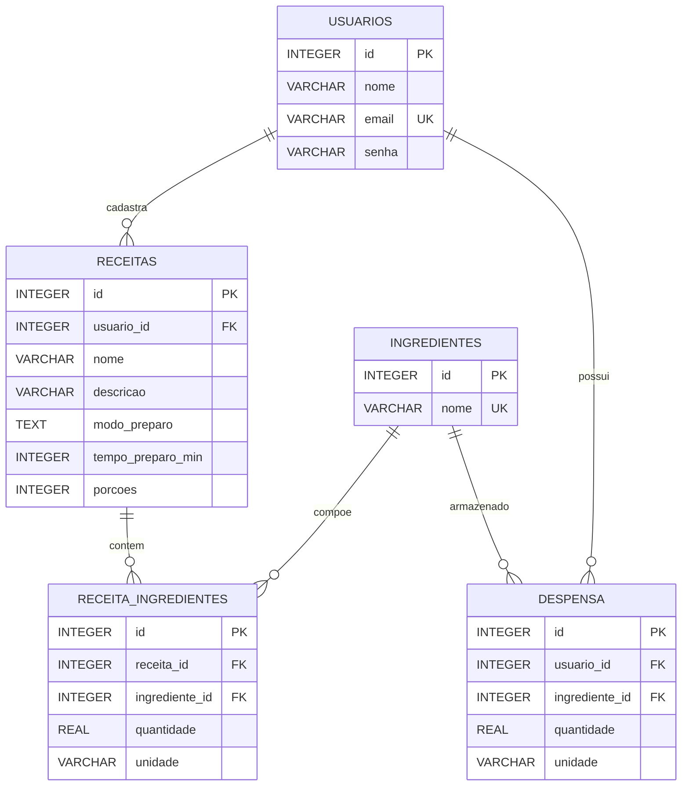

# Modelagem de dados — Cozinha em Dia

## Diagrama entidade-relacionamento

## Entidades e responsabilidades

| Entidade/tabela | Responsabilidade | Campos importantes |
|---|---|---|
| `usuarios` | Conta e dados próprios do usuário | `id`, `nome`, `email`, `senha` (hash BCrypt) |
| `receitas` | Receita cadastrada por um usuário | `id`, `usuario_id`, `nome`, `descricao`, `modo_preparo`, `tempo_preparo_min`, `porcoes` |
| `ingredientes` | Catálogo de ingredientes reutilizável | `id`, `nome` |
| `receita_ingredientes` | Tabela associativa entre receita e ingrediente, com quantidade requerida | `receita_id`, `ingrediente_id`, `quantidade`, `unidade` |
| `despensa` | Quantidade de cada ingrediente mantida por cada usuário | `usuario_id`, `ingrediente_id`, `quantidade`, `unidade` |

## Cardinalidades

- Um usuário pode cadastrar várias receitas; cada receita pertence a um usuário.
- Uma receita pode conter vários ingredientes; um ingrediente pode aparecer em várias receitas. A tabela `receita_ingredientes` resolve esse relacionamento N:N e armazena quantidade e unidade específicas para aquela receita.
- Um usuário pode ter vários ingredientes na despensa; o mesmo ingrediente pode estar na despensa de vários usuários. A tabela `despensa` resolve esse relacionamento e guarda o estoque individual.

## Regras de negócio do protótipo

1. O e-mail é único e a senha é armazenada como hash, não em texto puro.
2. As páginas de receitas e despensa trabalham somente com dados associados ao usuário da sessão.
3. Quantidades precisam ser maiores que zero.
4. Ao adicionar novamente um ingrediente que já está na despensa com a mesma unidade, a quantidade é somada. Se a unidade for diferente, o sistema pede para remover e recadastrar o item para evitar misturar unidades.
5. Uma receita fica **disponível** quando há quantidade suficiente de todos os seus ingredientes; **parcial** quando há algum estoque correspondente, mas ainda falta quantidade ou ingrediente; e **indisponível** quando nenhum item requerido tem estoque correspondente suficiente para avançar.
6. A comparação exige a mesma unidade para o ingrediente nas duas tabelas. Conversões como `kg` ↔ `g` ficam fora deste protótipo.

## Por que existem duas tabelas associativas?

`receita_ingredientes` e `despensa` não são tabelas duplicadas. A primeira registra a quantidade necessária para fazer uma receita; a segunda registra o que um usuário tem disponível em casa. A regra central do sistema compara esses dois conjuntos por ingrediente, quantidade e unidade.
